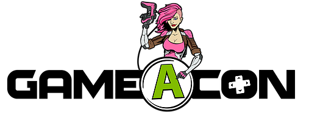
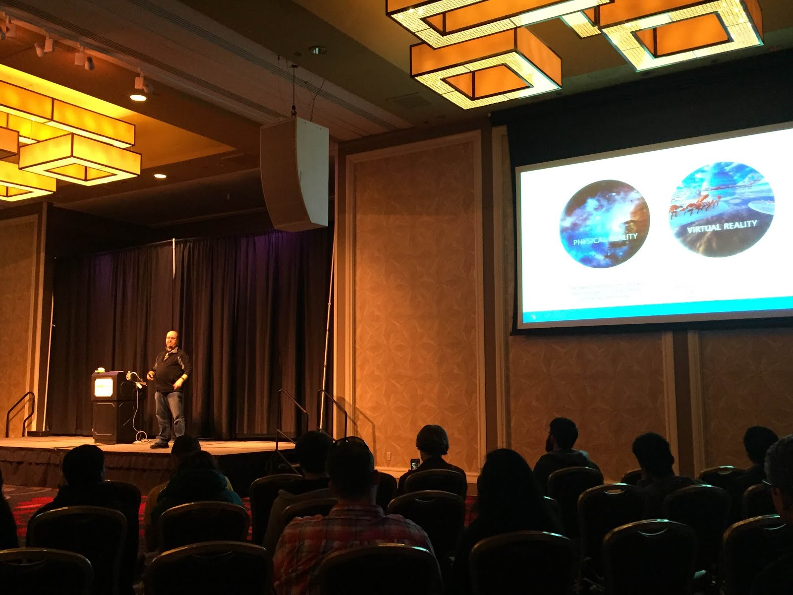
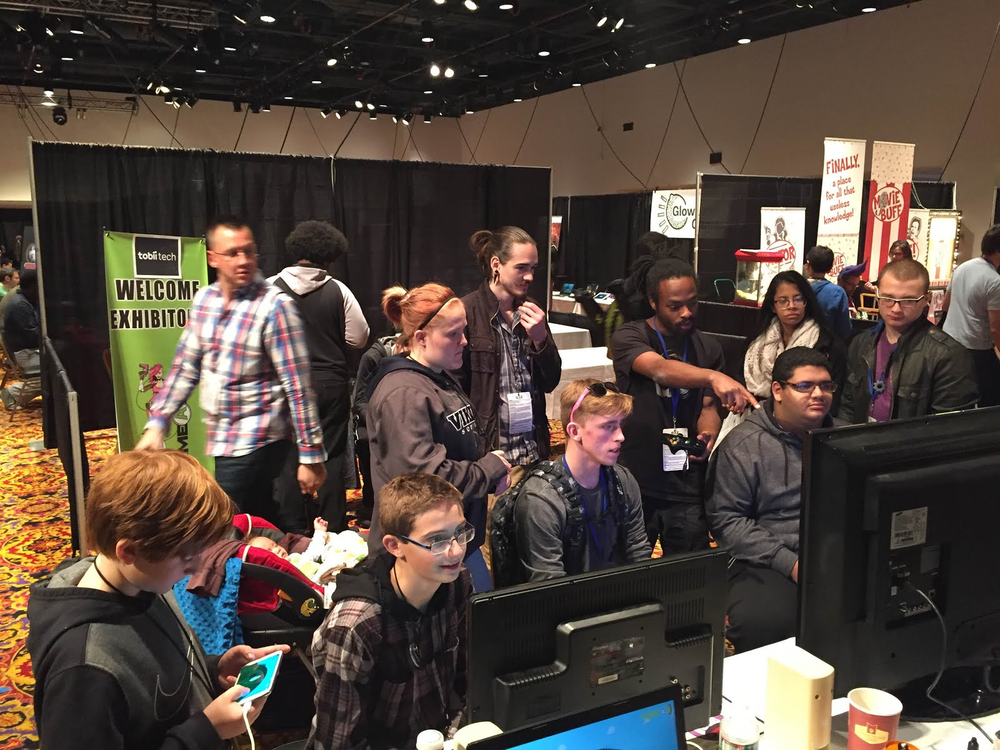
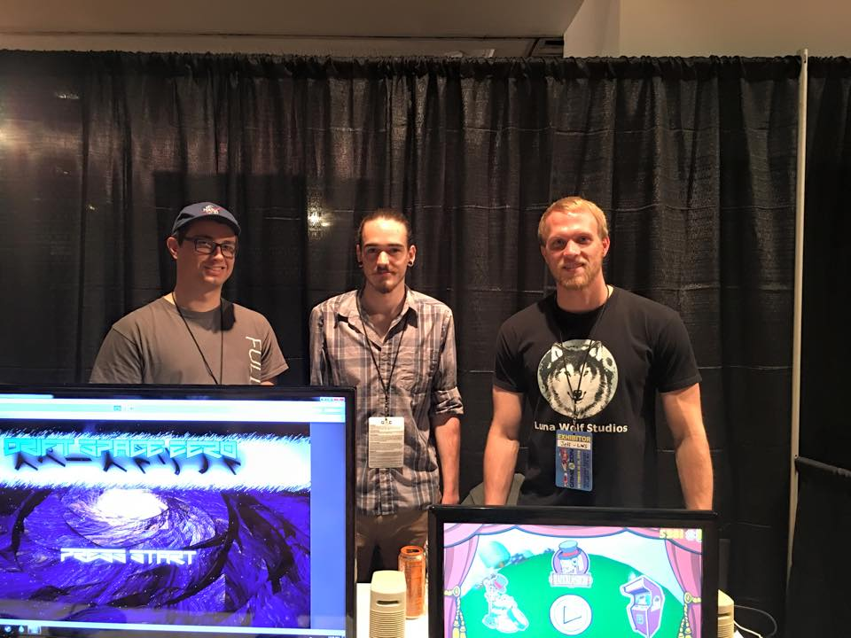
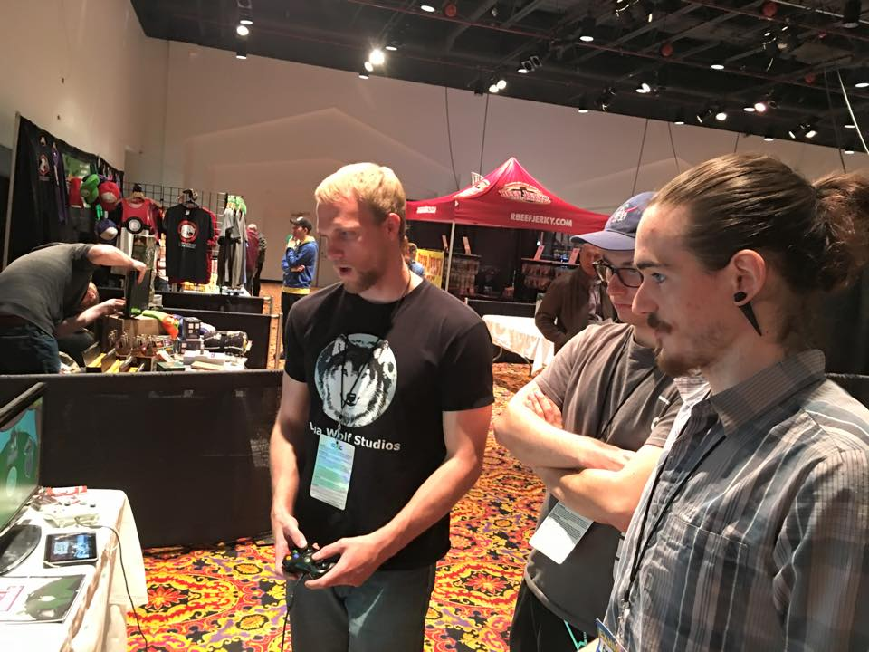
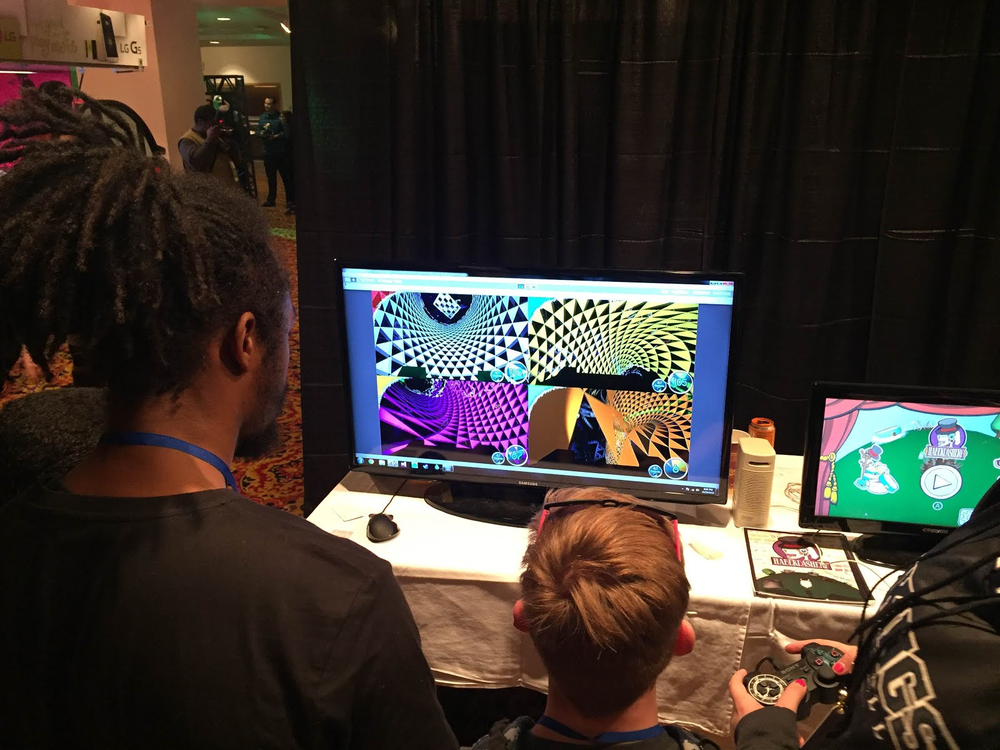

Another great year in Atlantic City for [GameACon](http://www.gameacon.com/) 2016! This year we had the pleasure of showcasing our classic mobile game _[Haberdashery](http://www.indiedb.com/games/haberdashery) _alongside our new game [Turbo Hobo Cannon](http://www.newgrounds.com/portal/view/675589), and a new multiplayer game by one of our co-workers/colleagues called _Drift Space Zero._

_Microsoft [HoloLens](https://www.microsoft.com/microsoft-hololens/en-us) Panel_

Returning to the [Tropicana Casino](https://tropicana.net/) is always a sure fire way you know you’re going to have a successful and fun weekend. Our first day was networking and panel day. We had a blast meeting up with some talented people including the [Party Nerdz](http://wildfireradio.com/partynerdz-podcast/) podcasters, and a company know as [Affectiva](http://developer.affectiva.com/) that specializes in facial recognition software. The panels this year were well executed and quite informative. We got to learn about innovative eye tracking software created by [Tobii Technology](http://www.tobii.com/), mixed reality with the [Microsoft HoloLens](https://www.microsoft.com/microsoft-hololens/en-us), and even [Kate](https://www.igda.org/?page=staff)[Edwards](https://www.igda.org/?page=staff), the executive director for the [IGDA](https://www.igda.org/), gave an excellent talk on the state of the game industry. That night there was a delicious happy hour at [Chickies and Petes](http://chickiesandpetes.com/) where we got to network, and fuel up on cheesy fries for the upcoming busy day of showcasing.

This year we opted for a more simple and spacious setup, with 2 TVs, some controllers, and a few tablets. The crowd this year was fantastic! Everybody was fun to talk to and had great input on all our games. We had the multiplayer racing game _Drift Space Zero_ on the big screen, and _[Haberdashery](http://www.indiedb.com/games/haberdashery)_ on tablets as well as a smaller TV. As usual _[Haberdashery](http://www.indiedb.com/games/haberdashery) _took form as the natural day care of the convention, and we even had some returning fans trying to beat each others high scores.

  

Thanks again for another great con [GameACon](http://www.gameacon.com/)! Next week is [Delaware Innovation Week](http://2016.delawareinnovationweek.com/), and will be demoing on 11/16 for [Tech2Gether](http://tech2gether.org/) at the [World Cafe Live](http://www.worldcafelive.com/). This is the [Luna Wolf Studios](http://www.lunawolfstudios.com/) and _[Haberdashery](http://www.indiedb.com/games/haberdashery)_ team signing off. Cheers!
