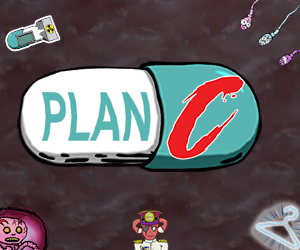
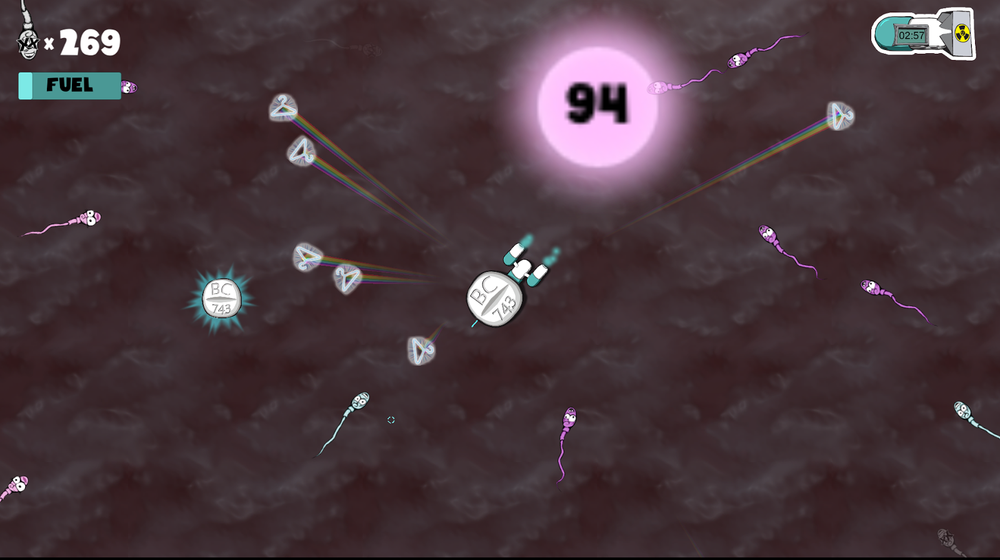
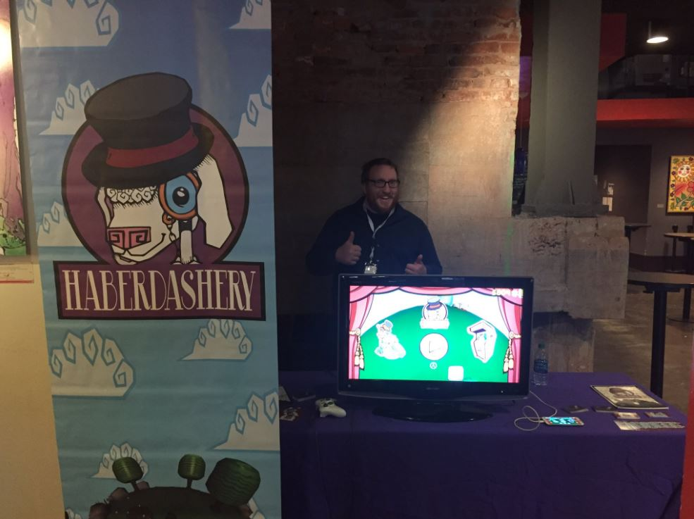
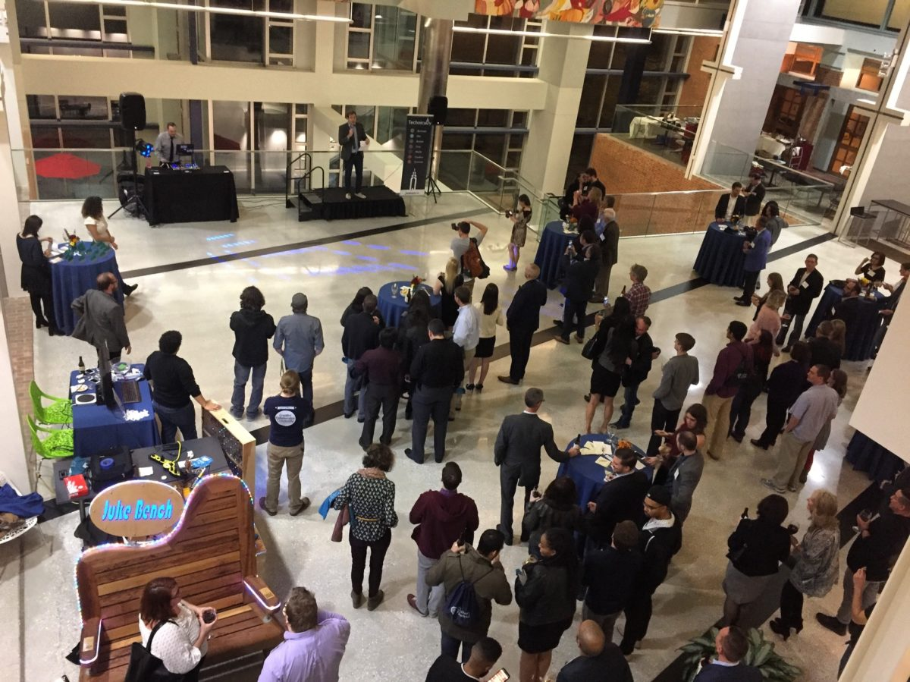

_(The post's own 435x280 copy of this image was already missing from the old site when it was archived in November 2026. This is the same art from the media library.)_

Delaware Innovation Week ([link](http://2016.delawareinnovationweek.com/)) came and went right before our eyes. Delaware Innovation Week, or DIW for short, is a week long innovation celebration with events, panels, contests, and endless networking all week long. This year it was hosted by [Technically Delaware](http://technical.ly/delaware/), sponsored by [1313 Innovation](http://1313innovation.com/), and took place from November 11th to the 18th. Here at [Luna Wolf Studios](http://www.lunawolfstudios.com/) we had the pleasure of competing in the [East Coast Reboot Game Jam](http://blog.wilmu.edu/ecrb/), showcasing [Haberdashery](http://www.indiedb.com/games/haberdashery) at [Tech2gether](http://tech2gether.org/), and even being [nominated](http://technical.ly/delaware/2016/10/24/nominees-2016-delaware-innovation-awards/) for Delaware’s Indie Video Game of the Year!

### **East Coast Reboot**

The kickoff for Delaware Innovation Week this year was the [East Coast Reboot](http://blog.wilmu.edu/ecrb/), which is a technology event that hosts dozens of judged competitions. The event is sponsored by [Wilmington University](http://www.wilmu.edu/) and run by [Scott Shaw](https://youtu.be/Z_cEQGDgS7c) alongside the [College of Technology](http://www.wilmu.edu/technology/indext.aspx). Last year we won the Game Jam event with our game [Fungeon Crawler](https://indiegamestand.com/free-games/1756/fungeon-crawler/), and this year we titered with the idea of competing again. It wasn’t until the day of that I decided to register for the event. Courtesy of [Heavy Key Studios](http://www.heavykeystudios.com/) for talking me into it.

Every year there is a theme that your game must be based around, this year’s was ‘Eggs’. So while I was at work I had all sorts of ideas running through my head. Once off work, I called up my [art guru Nate Flynn](http://undercog.com/), and pitched to him what I had in mind. He was instantly onboard! So we delved into yet another project as programmer and artist. This was the smallest team size we ever had for a game jam, and so we went with a smaller scope than usual. Undoubtedly we could have gone larger, as both Nate and I found that this jam was unlike the usual jams, and by that I mean we got to sleep, chill in hot tubs, and even find time for some apartment hunting. Maybe NoDoz and Adderall aren’t requirements to game jams? When we did get to work it was a grind, and having worked on multiple projects with one another previously everything seemed to come together without a hitch. The only hiccup involved porting to WebGL, which we later found out was not a requirement, and a PC or MAC build would have sufficed. _Oh well_, I guess that’s what happens when you miss the opening announcements to see [Karl Kapp](http://karlkapp.com/) talk about [gamification](https://en.wikipedia.org/wiki/Gamification) instead.

So we submitted our game and eagerly awaited for the winner to be announced. This year 6 teams competed and all 6 submitted finished games! I got to play a few of them including [The Yolk of Life](https://drive.google.com/file/d/0B65q53MzcbHIOHlsazRLQkwyOTQ/view) and [Eggstreme Eggscape](https://developer.cloud.unity3d.com/share/Wy1mjy6-n-/webgl/). Heavy Key Studios came in 2nd and made a fun two player versus game.

##

_Screenshot of Plan C_

Our game was a bit different than the others. Our approach to the theme of ‘Eggs’ was more of the mammal kind. While everyone else’s games were about chickens, laying eggs, and hatching eggs, ours was about sperm and preventing pregnancy. We created a swarm defense game, called[Plan C](http://www.newgrounds.com/portal/view/684730), where you’re a birth control pill defending your egg till Plan B comes along. [Jason Morano](http://sparkypants.com/team) from [SparkyPants Studios](http://sparkypants.com/) was the judge for this years competition, and he awarded us 1st place, saying we stood out with a polished game that made him laugh. Naturally a game like Plan C had to go up on [Newgrounds](http://www.newgrounds.com/portal/view/684730) so we added some medals and leaderboards, and sent it home.

### **Tech2gether**

This fall I’ve had the pleasure of working at [1313 Innovation](http://1313innovation.com/). As a fellow for 1313 I got to help out with getting [Tech2gether](http://tech2gether.org/) planned, marketed, and live. 1313 had me judging pitch competition entries, filling the swag bags, posting on social media, and making dozens of fliers to grab everyone’s attention. It was the first major event I got to partake in planning, and I’d say it went well!

 _Our own Jeremy Bregermann manning the booth at Tech2gether_

[Tech2gether](http://tech2gether.org/) is the largest tech conference in Delaware, and this year they had a demo pit, panel talks, [pitch contest](http://tech2gether.org/pitch-competition/), an AR/VR room, and not to mention food/drinks. Needless to say, it was an awesome time to be a techy in Delaware! After helping 1313 setup at the [World Cafe Live](http://www.worldcafelive.com/wilmington/), I had to switch hats to game developer and start showcasing [Haberdashery](https://indiegamestand.com/free-games/2198/haberdashery/). I had a pleasure talking to some of the other companies in the demo pit such as [InsiteHub](http://www.insitehub.co/), [Barrel of Makers](http://barrelofmakers.org/), and [Symbiosys](http://www.symbiosysconsulting.com/). I even managed to find time to watch another fellow at 1313, [Garry Johnson](https://twitter.com/GarryJohnsonIII), give his pitch for his non-profit startup idea _Creative Minds_.

_Everyone waiting eagerly for the DIW awards_

###
To wrap up Delaware Innovation Week there was a closing ceremony, where [Delaware Innovation Awards](http://technical.ly/delaware/2016/10/24/nominees-2016-delaware-innovation-awards/) were handed out. The awards were open to the public for voting, and some of the categories included Tech Mission Org of the Year, Dev Product of the Year, and a new category called Indie Video Game of the Year. Our game [Haberdashery](http://www.indiedb.com/games/haberdashery) was actually nominated for Indie Video Game of the Year. [Blind Blades](http://store.steampowered.com/app/522000/), by [Heavy Key Studios](http://www.heavykeystudios.com/) ended up taking the award this year, and I have to say it is an awesome game that you definitely need to check out! You can view all of this years winners [here](http://technical.ly/delaware/2016/11/21/delaware-innovation-awards-winners/).

### **Delaware Innovation Awards**

### This years [Delaware Innovation Week](http://2016.delawareinnovationweek.com/) was full of good times, and I’ll definitely be looking forward to next years! Great job by [Technically DE](http://technical.ly/delaware/) for organizing this week long event throughout all of Delaware. Thanks for reading!
