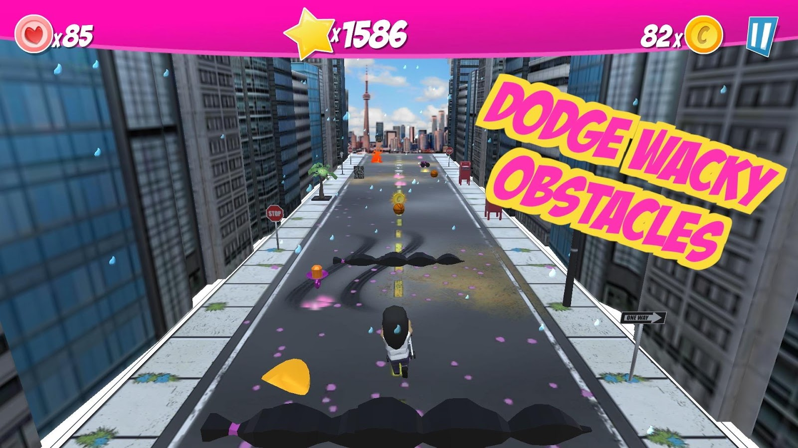
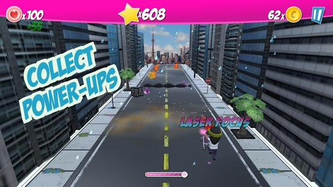

Delaware game development company [Luna Wolf Studios](http://www.lunawolfstudios.com/) recently released their biggest hit yet called ‘[Save Samia](http://savesamia.com/)’, which was developed for Canadian YouTube sensation [LaToyaForever](https://www.youtube.com/user/latoyaforever). The game was released October 7th, 2016 and has already received tremendous adoration and wonderful reviews. With over a 4.8 on [Google Play](https://play.google.com/store/apps/details?id=com.latoyaforever.savesamia)and thousands of downloads daily ‘Save Samia’ is quickly climbing the iOS and Google Play charts even reaching top 150 for free arcade games on iOS.

Currently available for free on [Android](https://play.google.com/store/apps/details?id=com.latoyaforever.savesamia), [iOS](http://tiny.cc/savesios), and [Facebook](https://www.facebook.com/SaveSamia). Save Samia will keep you entertained with laughs from start to finish. Play as LaToya or play as her friends, collect various power ups, and avoid wacky obstacles. Running through the streets of Toronto has never been more fun! Download now for free on [iOS](https://itunes.apple.com/us/app/save-samia/id1144180928?mt=8) and[Android](https://play.google.com/store/apps/details?id=com.latoyaforever.savesamia), and start working your way to the top of the Leaderboard.

[Luna Wolf Studios](http://www.lunawolfstudios.com/) headed the development process and formed a small team of passionate developers, mostly of [Wilmington University](http://www.wilmu.edu/) students in Delaware. The team was five people: a project lead and programmer, a 3D asset artist, a 3D environment and prop artist, a 3D character artist and animator, and, from London, a 2D user interface artist. _(Names and personal links were removed from this archived copy at the owner's request in November 2026.)_ The voice overs, sound effects, and music were provided by LaToya and her team.

