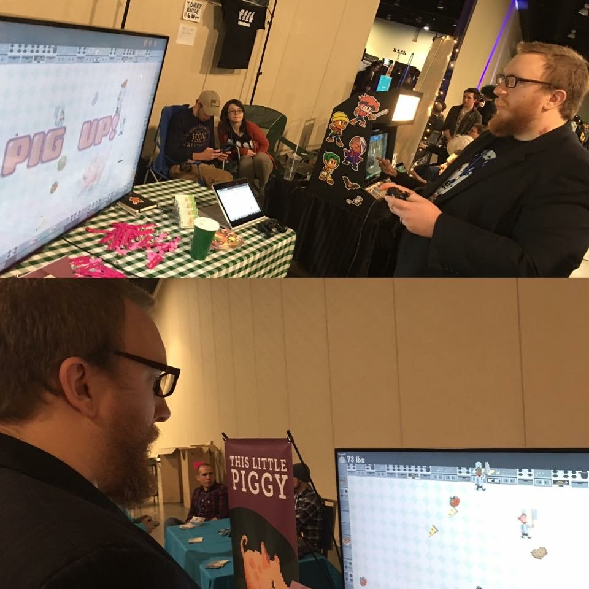
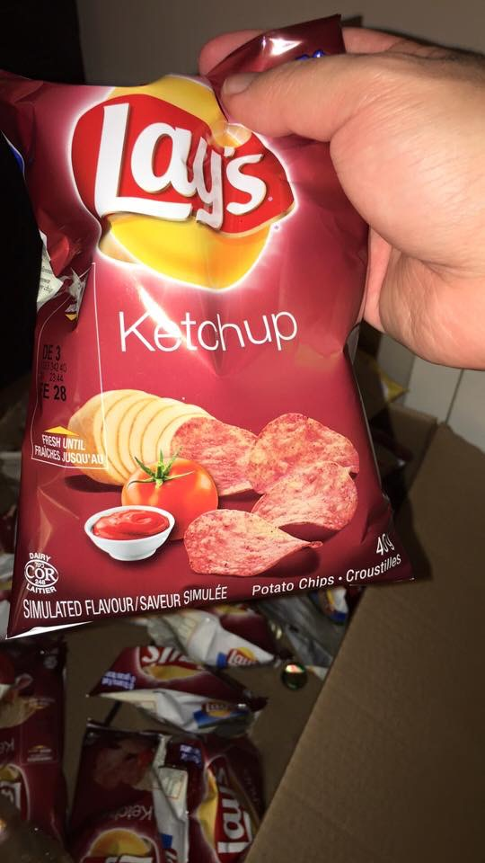

# MAGFest 2017

 Out of all of the conventions and events that I’ve been to, [MAGFest](http://magfest.org/) is still my favorite. While we did not show any games, the

atmosphere of being surrounded by people who are as passionate about

games as you are is incredible. I had the pleasure of seeing old friends like Ben Cole at [PXLPLZ](https://twitter.com/pxlplz?ref_src=twsrc%5Egoogle%7Ctwcamp%5Eserp%7Ctwgr%5Eauthor), who are creating the awesome [Robo Puzzle Smash](http://www.robopuzzlesmash.com/) which can be found on [Steam](https://steamcommunity.com/sharedfiles/filedetails/?id=828299702), as well as the good folks at [Heavy Key Studios](http://www.heavykeystudios.com/).

Overall, good times were had! I had the privilege of spending time at the Canadian Embassy. Catching up with the incredibly talented [Alyssa Menes](http://portfolio.acmenesmusic.com/), the always awesome [Chris Cheng](https://twitter.com/yougotcheng?lang=en), and even the old crew from high school! There were many incredible parties and fun times spent in the arcade. I always make sure to play at least a round or two of Crazy Taxi, the arcade version, which I did poorly on this year, just more motivation to score high at [MagLabs](http://magfest.org/maglabs) in September.

All that and more sums up an amazing MAGFest, what happens at MAGFest stays at MAGFest! Until next time, this is Jeremy signing out.

 Ketchup potato chips: The glory of Canada!
