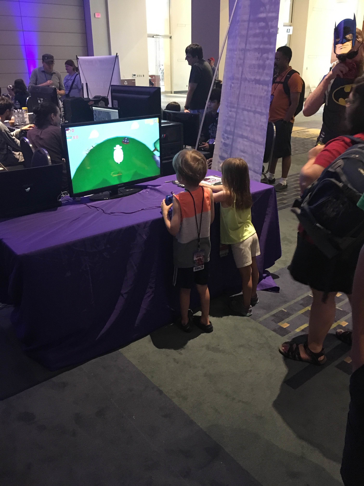

What a summer it has been! You may have noticed we have not done as many shows as our regular summer slates and that is for good reason, friends. We here at Luna Wolf Studios have been chugging away at some very exciting new games that we hope you will someday enjoy.

We met many of you at [AwesomeCon](http://awesome-con.com/) way back in June, and, like the name suggests, it was pretty freaking awesome. It was very humbling to see so many people get to enjoy [Haberdashery](https://lunawolfstudios.com/games/haberdashery) and the excitement when they found out it was not only available, but also for free, it was priceless.

        

**What are we up to?**

We have been hard at work on a new competitive RTS/MOBA game called [Sheep Tag 2](http://www.sheeptag2.com/) this is by far one of our bigger projects to date, and building a multiplayer RTS engine inside Unity is no easy task! But we have made outstanding progress nonetheless, and thanks to the amazing [Quaternius](http://www.quaternius.com/portfolio.html) we have some beautiful low poly models to boot.

_(Image not recoverable: it was already missing from the old site when the blog was archived in November 2026.)_

**…But what is ‘Sheep Tag’?**

Sheep Tag is one of the most unique, heart-pounding, challenging, and overall fun game there is. In Sheep Tag there are two teams, Sheep and Shepherd. The Sheep must survive a specified amount of time, and the Shepherd’s must capture all the Sheep before that time runs out. The Sheep are captured in one fell swoop, but they can be saved/revived by their allies. This creates an interesting RTS map control mechanic. Wherein the Shepherds need to capture all the Sheep, but leaving the Pen, where captured sheep go, poses a risk that one might get saved. Sheep can also build farms as a means of defense. Shepherds are twice the size of Sheep, so the Sheep can build in a grid like fashion to move about safely. To learn more about Sheep Tag terminology and history visit the [Sheep Tag Wiki](http://sheeptag.wikia.com/wiki/Sheep_Tag_Wiki)!

Keep up to date on [Sheep Tag 2](http://www.sheeptag2.com/) by subscribing to the Newsletter, and joining our public [Discord](https://discord.gg/Y4dHvwX)chat. Links for all things St2 (Sheep Tag 2) can be found at http://www.sheeptag2.com

We also have been collaborating with our friend at Geek Monster Games on a project that we are keeping under wraps for now, don’t want to spoil the big reveal yet, but expect to know much more in the coming months *cough* [MAGFest](http://super.magfest.org/) *cough*

**But wait…there’s more**

In addition to all of that excitement, Jeremy Bregermann has been lending his 3D animation and weighting skills to a yet-to-be-announced project from [Bamn Studios](http://bamnstudios.com/index.php), and while we would love to show you his work here, we cannot at this time. Side note: if you’d like to hire an animator, he’s your guy!

**Upcoming Events**

Catch us this Saturday, September 9th, at [A Video Game Con](http://www.avideogamecon.com/) where we’ll be giving a panel talk on Indie Game Development at noon in panel room 2. We’ll be alongside Tetricom Studios, and the talented artist, from our hit game ‘[Save Samia](http://savesamia.com/)’. UPDATE: We will have a booth on Saturday, so come by and check us out there!
