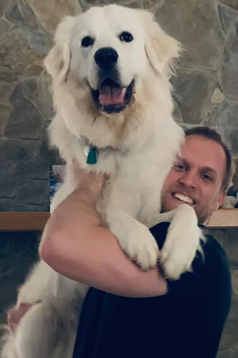

### Jeff

**Co-Founder of Luna Wolf Studios**

With a strong foundation in engineering, I specialize in developing innovative software solutions that blend technical expertise with engaging design. I’ve spent over a decade creating immersive experiences that solve real-world problems through the neuroscience of play, using games, tools, and platforms that educate, motivate, and create lasting impact.

Specializing in Unity and XR technologies, I’ve led cross-disciplinary teams in creating a diverse array of gamified experiences—from multiplayer strategy games to educational experiences and medical simulations. These projects have empowered organizations to launch FDA-approved treatments, gamify complex training protocols, and improve learning engagement.

I’ve delivered real-time interactive systems that integrate motion capture, electromyography, and other alternative control mechanisms. These systems enhance accessibility and provide data-driven insights for patient therapy, fitness, and STEM education. My work in this space has helped clinicians track patient progress remotely, provided kids with physical limitations a new way to engage with therapy, and brought measurable improvement to user outcomes through personalized gameplay.

In the cloud, I’ve architected and deployed low-latency gaming platforms using Unity, AWS, and WebRTC. These solutions allowed clients to securely stream fully interactive 3D simulations over low-bandwidth networks, unlocking entirely new deployment models for high-performance content. I’ve also built containerized infrastructure and CI/CD pipelines that automated Unity builds and service deployments, reducing release cycles and improving stability across web, mobile, and VR environments.

Beyond engineering, I’ve supported clients through video production, content creation, web development, and community management. This has helped teams launch with a cohesive brand presence and tools to grow their audience. This holistic approach has consistently led to successful product launches, meaningful player engagement, and long-term platform sustainability.

At the core of every project, I aim to push the boundaries of what games can do—combining technology and design to deliver experiences that matter.

### My Portfolio

**Health and Fitness Games**

• [HELIX](https://lunawolfstudios.com/helix/) by Luna Wolf Studios

• [Lanebreak](https://www.onepeloton.com/bike/lanebreak) by Peloton

• [SaeboVR](https://www.barron-associates.com/about/projects/saebovr-upper-extremity-therapy-software/) by Barron Associates

• [KneeBRIGHT](https://www.barron-associates.com/about/projects/kneebright/) by Barron Associates

• [MOVE-IT](https://www.barron-associates.com/awards/barron-associates-to-develop-telehealth-system-for-pediatric-upper-extremity-therapy/) by Barron Associates

• [iCARE](https://www.barron-associates.com/about/projects/vision-therapy-based-on-computer-gaming/) by Barron Associates

**Educational Games**

• [NeuroSPARKS](https://www.barron-associates.com/about/projects/neurosparks/) by Barron Associates

• [EMPATHIE](https://www.barron-associates.com/research-updates/barron-associates-completes-pilot-testing-with-middle-school-students-for-empathie-video-game/) by Barron Associates

• [Lab Rat](https://www.legendsoflearning.com/) by Legends of Learning

**Indie Games**

• [Hypno Halo](https://store.steampowered.com/app/3847950/Hypno_Halo/) by Luna Wolf Studios

• [ParaLily](http://paralilygame.com/) by Luna Wolf Studios

• [Sheep Tag 2](https://store.steampowered.com/app/537680/Sheep_Tag_2/) by Luna Wolf Studios

• [Travelers Refrain](https://store.steampowered.com/app/2679660/Travelers_Refrain/) by Red Essence Games

• [Cell to Singularity](https://celltosingularity.com/) by Computer Lunch

• [Citytopia](https://nvizzio.com/game/citytopia/) by Reliance Games

• [Save Samia](https://www.youtube.com/watch?v=UOKxWUQqUD4&t=58s) by LaToya Forever

• [Haberdashery](https://lunawolfstudios.itch.io/haberdashery) by Luna Wolf Studios

• [Target Crack](https://lunawolfstudios.itch.io/target-crack) by Luna Wolf Studios

• [Madlads Tic Tac Toe](https://games.lunawolfstudios.com/madlads-tic-tac-toe/) by Luna Wolf Studios

**Game Jams**

• [OK K.O.! Under Siege](https://www.youtube.com/watch?v=52Ly5DmDsvk) by Cartoon Network

• [Plan C](https://lunawolfstudios.itch.io/plan-c) by Luna Wolf Studios

• [Turbo Hobo Cannon](https://lunawolfstudios.itch.io/turbo-hobo-cannon) by Luna Wolf Studios

• [Lightning Luther](https://lunawolfstudios.itch.io/lightning-luther) by Luna Wolf Studios

• [A World Apart](https://lunawolfstudios.itch.io/a-world-apart) by Luna Wolf Studios

• [Fungeon Crawler](https://lunawolfstudios.itch.io/fungeon-crawler) by Luna Wolf Studios

**Web Apps**

• [Anatomy of Play](https://tools.lunawolfstudios.com/anatomy-of-play/) – Serious Games for Health and Fitness.

• [FishWatch](https://tools.lunawolfstudios.com/fishwatch) – Every second makes a ripple.

• [Reel Gains](https://tools.lunawolfstudios.com/reel-gains) – Track every rep. Catch every gain.

• [FinChat](https://github.com/LunaWolfStudios/finchat) – No nets. No traps. Just chat.

• [Fresh Catch](https://tools.lunawolfstudios.com/fresh-catch/) – Fresh List. Fresh Catch.

• [LifeQuest](https://games.lunawolfstudios.com/lifequest-the-next-level/dist/index.html) – The Next Level.

**Tutorials** **and Assets**

• [Scriptable Sheets for Unity](https://assetstore.unity.com/packages/tools/utilities/scriptable-sheets-284559)

• [Audio Tutorial for Unity: the Audio Mixer](https://www.kodeco.com/532-audio-tutorial-for-unity-the-audio-mixer)

• [How to Make a Match 3 Game in Unity](https://www.kodeco.com/673-how-to-make-a-match-3-game-in-unity)

• [ScriptableObject Tutorial: Getting Started](https://www.kodeco.com/2826197-scriptableobject-tutorial-getting-started)

• [Unity Cheat Sheet and Quick Reference 2018](https://www.kodeco.com/227-unity-cheat-sheet-and-quick-reference-2018)

• [How to Create a Tower Defense Game in Unity](https://www.kodeco.com/269-how-to-create-a-tower-defense-game-in-unity-part-1)

• [Setup a Bug Reporter in Unity using Trello](https://www.youtube.com/watch?v=ryXwG1j4rhI)

…and many many more.

### Contact

[Jeff@lunawolfstudios.com](mailto:Jeff@lunawolfstudios.com)
[LinkedIn](https://www.linkedin.com/in/jeff-f-567473ab/)
[GitHub](https://github.com/jfisher993)
