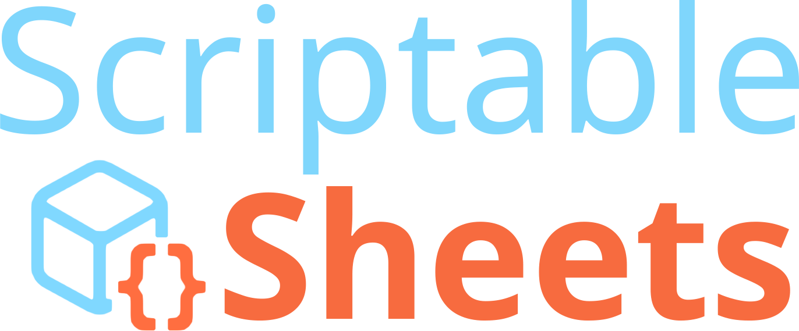
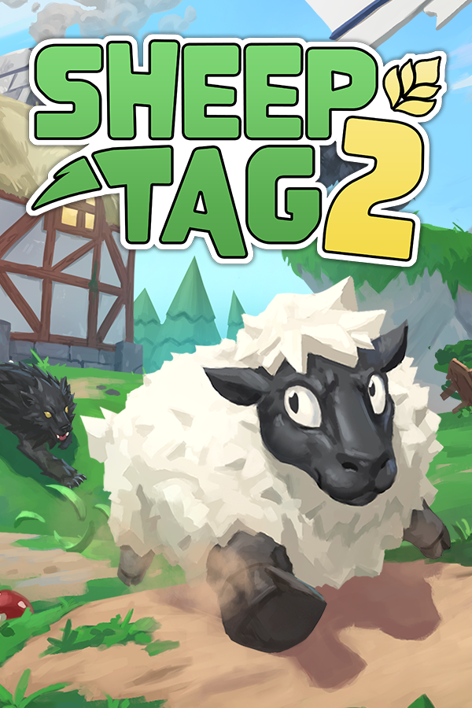
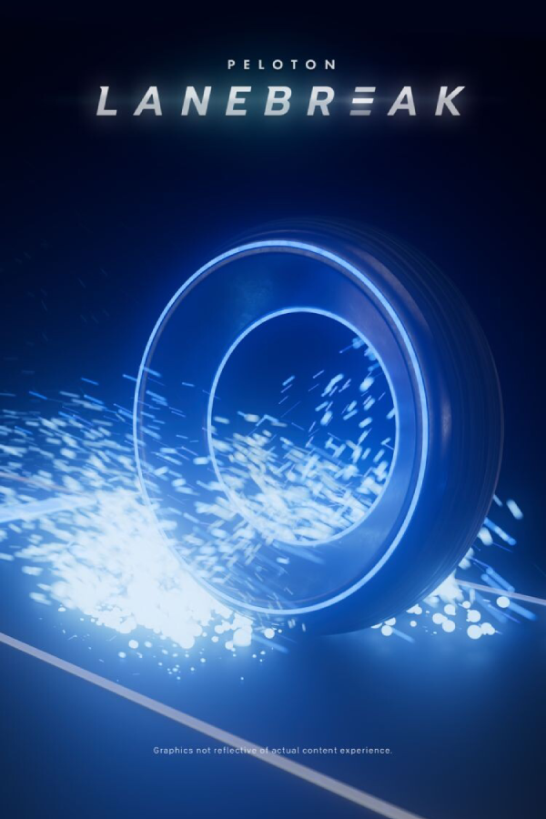
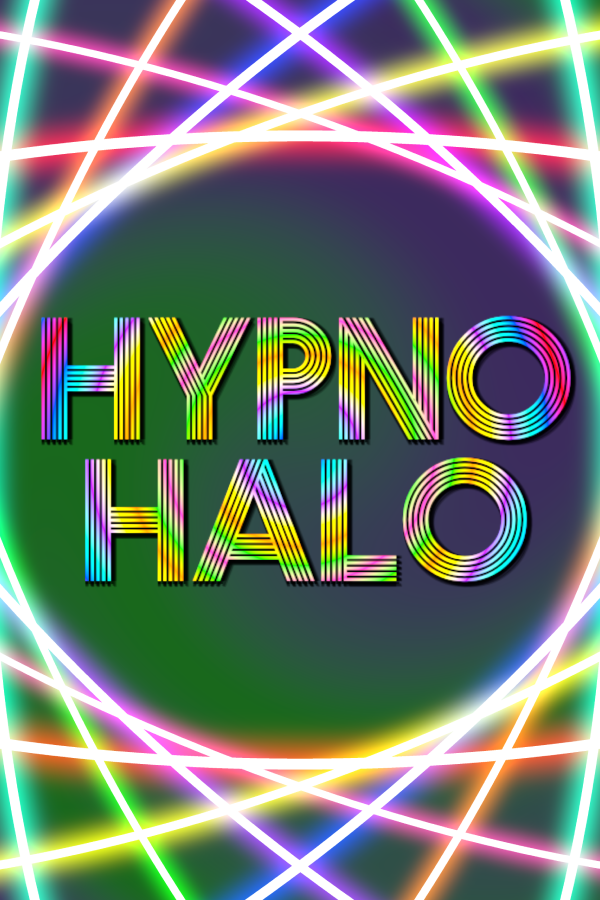
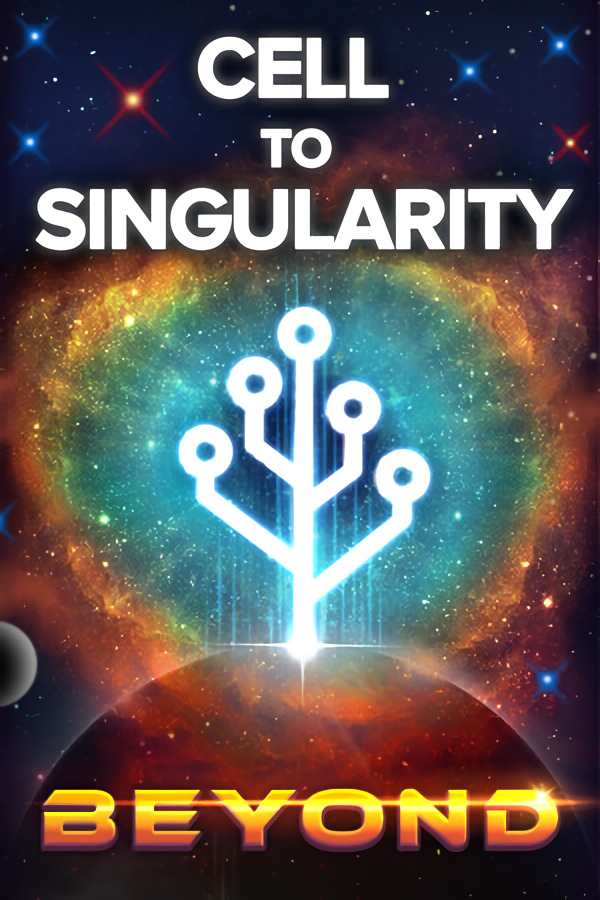
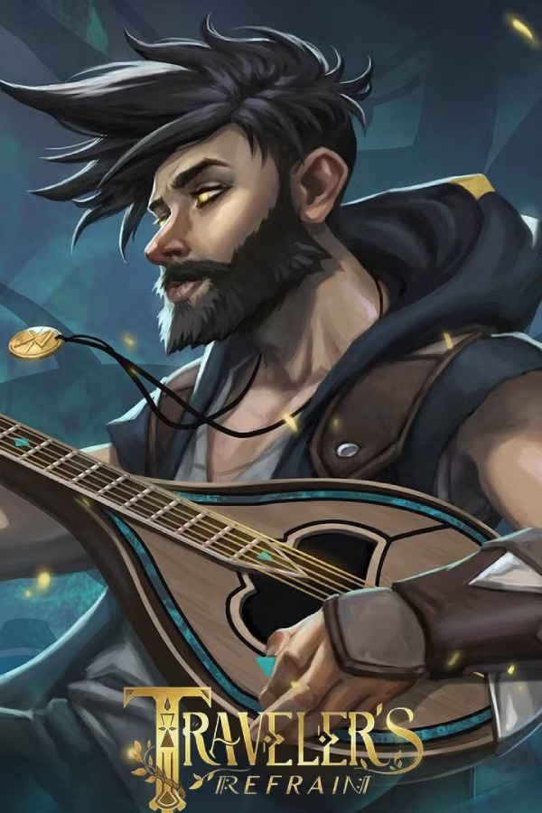
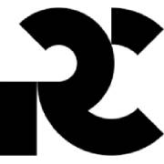

 ([link](https://assetstore.unity.com/packages/tools/utilities/scriptable-sheets-284559))

[Embedded video](https://www.youtube.com/watch?v=r_FJBZjHUpA)

 ([link](https://assetstore.unity.com/packages/tools/utilities/scriptable-sheets-284559))

### Showcase

 ([link](https://www.sheeptag2.com/))

 ([link](https://www.onepeloton.com/en-AU/blog/lanebreak))

 ([link](https://store.steampowered.com/app/3847950/Hypno_Halo/))

 ([link](https://celltosingularity.com/))

 ([link](https://paralilygame.com/))

 ([link](https://store.steampowered.com/app/2679660/Travelers_Refrain/))

[Contact Us](http://lunawolfstudios.com/contact/)

### Our Trusted Pack

 ([link](https://unity.com/))

 ([link](https://www.rc.enterprises/))

 ([link](https://www.onepeloton.com/))

 ([link](https://gumbonyc.org/))

 ([link](https://games.computerlunch.com/))

 ([link](https://www.cartoonnetwork.co.uk/))

 ([link](https://megacatstudios.com/))

 ([link](https://www.redessencegames.com/))

 ([link](https://store.looneylabs.com/))

 ([link](https://igda.org/))

 ([link](https://www.legendsoflearning.com/))

 ([link](https://www.kodeco.com/))

 ([link](https://www.barron-associates.com/))

 ([link](https://www.nemours.org/))

 ([link](https://www.mtrigger.com/))

 ([link](https://damoclesthreaddevelopment.wordpress.com/))

 ([link](https://fi.edu/en))

 ([link](https://dmi.edu/))

 ([link](https://www.cecil.edu/))

 ([link](https://illinois.edu/))

 ([link](https://dcad.edu/))

 ([link](https://www.smu.edu/))

 ([link](https://www.harrisburgu.edu/))

 ([link](https://www.wilmu.edu/))

### Our Howling Reviews

-
-
-
-
-
-

Hypno Halo mesmerizes with minimalist design and pure mechanics. The loop feels meditative and addictive. Halo aesthetics soothe and pull you into chasing high scores

-OFEN™

[Steam Curator](https://steamcommunity.com/groups/O-F-E-N/curation/app/3847950/)

A minimalist and elegant scoring game. Ideal for those who appreciate simplicity and beauty of form. The halo appears as a symbol of infinity and harmony. A very addictive and peaceful game.

-SOKOL

[Steam Curator](https://steamcommunity.com/groups/-SOKOL-/curation/app/3847950/)

This is incredibly powerful for my kind of a workflow. Being able to see every single member of a scriptable object in one view lets me see the bigger picture much more easily. Highly recommend this one.

-Quevanto

[Unity Asset Store](https://assetstore.unity.com/packages/tools/utilities/scriptable-sheets-284559#reviews)

I can’t express enough how AMAZING this asset is! If you work with ScriptableObjects, or any serializable asset supported by this tool that you want to edit in List format, this is the asset to buy!

-Katerlad

[Unity Asset Store](https://assetstore.unity.com/packages/tools/utilities/scriptable-sheets-284559#reviews)

So it’s come to this: I’ve reached the age where I get excited about an embedded spreadsheet tool. smh This is amazing! It helps structure my endless number of Scriptable Objects in my scene. Was about to write something myself, but this is well worth the money! <3

-deleo

[Unity Asset Store](https://assetstore.unity.com/packages/tools/utilities/scriptable-sheets-284559#reviews)

Quite powerful – especially for larger projects. If you organize data using scriptable objects in your project, this asset is going to be a huge time saver. Definitely a must have asset in my opinion!

-RestingOwl

[Unity Asset Store](https://assetstore.unity.com/packages/tools/utilities/scriptable-sheets-284559#reviews)

Peloton’s new gamified indoor cycling experience, Lanebreak, might be even more addicting than its workout classes. Spoiler alert: It’s a lot of fun.

-Angela Moscaritolo

[PCMag](https://www.pcmag.com/news/peloton-lanebreak-test-riding-the-addictive-fitness-game)

Perhaps the best part of Lanebreak is that it got me back cycling after several months of not doing so. It really made me fall in love with cycling all over again.

-Nicole Lee

[Engadget](https://www.engadget.com/peloton-lanebreak-irl-140011434.html)

For the first time, I can wrap my head around where immersive fitness might fit into the real world — and I like what I see.

-Victoria Song

[The Verge](https://www.theverge.com/2023/6/28/23775357/peloton-tread-lanebreak-immersive-fitness)

It’s like going deeper in Inception, and it’s extremely fun to play.

-Zach

[Everything Action](https://everythingaction.com/2017/09/21/gamebox-2-0-leatherface-legacy-edition/)

This game is spectacular. The puzzles are amazing, the art is amazing, the story is compelling and captivating. The game is very polished and a joy to play!

-Anonymous Judge

[MAGFest MIVS](https://super.magfest.org/mivs/)

Staring into space has never been this rewarding.

-Cathering Dellosa

[Pocket Gamer](https://www.pocketgamer.com/cell-to-singularity-beyond/review/)

Haberdashery proves that there’s still life and sillyness left in the endless runner genre.

–Vinny Parisi

[IndieGameMagazine](http://indiegamemag.com/screenshot-weekly-disposable-beards-on-sale-at-the-haberdashery/)

An interesting take on endless runners, you play as a sheep on a rotating 3D world collecting hats and coins while avoiding obstacles. Different powerups, items to catalog, and a global leaderboard give it good replay value. Overall super fun and hilarious game!

-Ruthiepee

Haberdashery iOS Review

Fun concept. Well put together. I can see it going places. Hats off to the dev.

-Anonymous Judge

[Boston Festival of Indie Games](https://www.bostonfig.com/)

I was laughing right when I opened it.

-Jason Morano

[ECRB Game Jam Judge 2016](http://www.sparkypants.com/team)

By far the best freelancer I’ve ever encountered. Even though they were under a strict time limit, they presented work that was by far that of perfection. Would love to work with them again!

-Sqe187

[Freelancer Review](https://www.freelancer.com/u/LunaWolfStudios.html)

You have created a beautifully creative, wonderfully imaginative, realistically difficult, and insanely addictive game. I tip my hats to you.

-RenfieldHarker

[Newgrounds Review](http://www.newgrounds.com/portal/view/658511)
